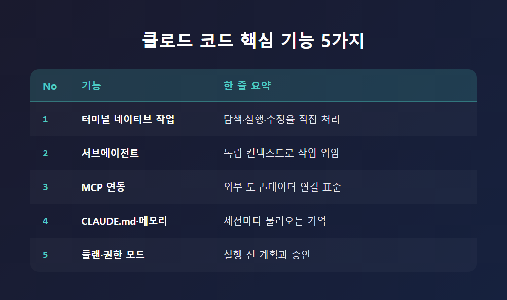
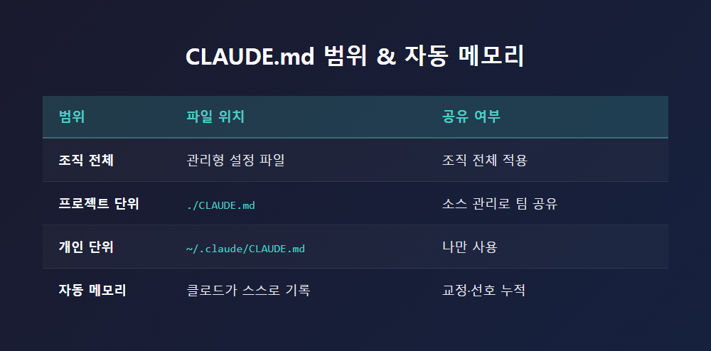
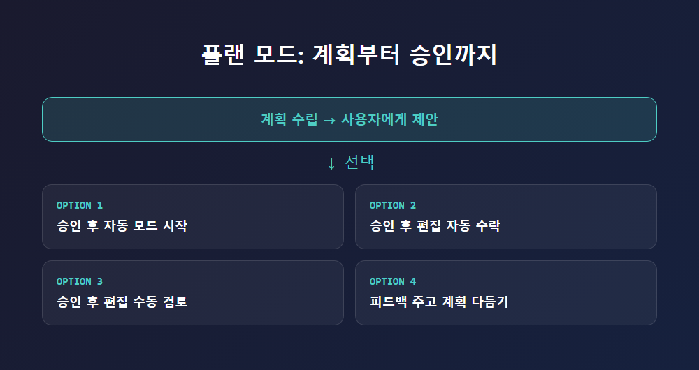

# 클로드 코드 핵심 기능 5가지: 터미널부터 메모리까지

터미널 창에 자연어로 명령을 입력했는데, AI가 코드베이스를 뒤져 파일을 고치고 git 커밋까지 만들어주는 장면을 본 적이 있을 겁니다. 흔히 "AI 코딩 도구"라고 하면 자동완성 정도를 떠올리지만, 클로드 코드(Claude Code)는 이 범주와는 조금 다른 자리에 있습니다. 코드를 "제안"하는 게 아니라, 직접 탐색하고 실행하고 검증하는 쪽에 가깝습니다. 이 글에서는 클로드 코드를 이해하는 데 핵심이 되는 5가지 기능을 살펴봅니다.

## 서론: 왜 "에이전틱 코딩"인가

클로드 코드는 터미널에서 실행되며 코드베이스를 이해하고, 자연어 명령으로 일상적인 개발 작업을 처리하는 도구입니다. 복잡한 코드를 설명하는 것부터 git 워크플로, 즉 커밋이나 PR 생성까지 처리할 수 있다는 점이 이 도구를 "에이전틱 코딩(agentic coding)" 도구로 부르게 만드는 근거입니다. 다만 이 정의가 실린 공식 개요 문서(`code.claude.com/docs/en/overview`) 원문은 이번 자료 조사에서 직접 확인하지 못했고, 다른 자료들이 이를 인용하는 형태로만 확인됐다는 점은 짚어 둘 필요가 있습니다. 아래에서 다섯 기능을 순서대로 짚어 보겠습니다.

## 1. 터미널 네이티브 작업: 설명에서 실행까지

클로드 코드의 가장 기본적인 기능은 터미널 안에서 코드베이스를 탐색하고, 셸 명령을 실행하고, 파일을 직접 수정하는 것입니다. 단순히 "이 코드가 뭐 하는 코드인지 설명해 줘" 수준을 넘어, 테스트를 실행하거나 git 작업을 관리하는 것까지 포함됩니다. 개발 환경과 직접 상호작용한다는 점이 핵심입니다.

터미널에만 묶여 있는 도구는 아닙니다. IDE 안에서 쓰거나, GitHub에서 `@claude`를 태그해 호출하는 방식도 지원됩니다. 설치 방법으로는 curl 스크립트, Homebrew, WinGet이 권장되고, npm을 통한 설치는 더는 권장되지 않는다고 안내됩니다. 다만 이 설치 관련 정보는 버전별 스냅샷 자료에서 확인된 것이라, 현재 시점과는 차이가 있을 수 있습니다.

## 2. 서브에이전트: 일을 나눠서 맡기는 구조

클로드 코드에는 서브에이전트(subagent)라는 개념이 있습니다. 자신만의 컨텍스트 창(context window), 커스텀 시스템 프롬프트, 그리고 자신만의 도구 접근 권한을 가진 별도의 보조 에이전트입니다. 메인 작업을 하다가 특정 조건에 맞는 서브에이전트에 일을 넘기면, 그 서브에이전트가 독립적으로 작업을 수행하고 결과만 반환하는 구조입니다. 비유하자면, 본인이 직접 모든 서류를 뒤지는 대신 전담 담당자에게 조사를 맡기고 보고서만 받는 것과 비슷합니다.

서브에이전트는 파일 시스템 기반으로 만들어집니다. YAML 형식의 머리말이 붙은 마크다운 파일을 지정된 폴더에 두는 방식으로, 프로젝트 단위 서브에이전트는 `.claude/agents/`, 개인 단위 서브에이전트는 `~/.claude/agents/`에 둡니다. 프로젝트 단위 파일을 버전 관리에 포함시키면 팀원들이 함께 쓰고 고칠 수 있다는 점도 특징입니다.

Explore, Plan, general-purpose 같은 내장 서브에이전트도 포함되어 있습니다. 예컨대 Explore는 Haiku 모델 기반의 읽기 전용 에이전트로, 파일 탐색과 코드 검색에 특화되어 있다고 설명됩니다. 다만 여러 세션에 걸쳐 병렬로 협업하는 에이전트가 필요하다면 서브에이전트가 아니라 별도 기능인 "에이전트 팀(agent teams)"을 쓰도록 안내됩니다. 서브에이전트는 하나의 세션 안에서만 동작하는 셈입니다.

## 3. MCP 연동: 외부 도구와 연결하는 표준

MCP(Model Context Protocol)는 Anthropic이 만든 개방형 표준으로, AI 모델이 로컬 데이터, 외부 도구, 데이터베이스 등과 상호작용할 수 있게 해주는 역할을 합니다. 클로드 코드에서는 클로드 코드 자체가 클라이언트가 되고, 각 MCP 서버가 하나의 외부 시스템과 연결되는 구조입니다. MCP 서버는 도구, 리소스, 프롬프트, 외부 이벤트를 노출할 수 있고, 연결 방식으로는 로컬 명령 실행 방식(stdio), HTTPS 연결 방식(SSE·HTTP), WSS 연결 방식(WebSocket) 등이 쓰인다고 설명됩니다.

다만 이 기능에 대해서는 한 가지 짚어둘 부분이 있습니다. 이번 조사에서는 Anthropic의 공식 MCP 설명 페이지 원문을 직접 확인하지 못했습니다. 위 설명은 모두 3차 가이드 자료를 통해서만 확인된 내용이라, 공식 문서와 대조된 것은 아닙니다. 보안 측면에서는 신뢰할 수 있는 서버만 연결하고 필요한 최소한의 권한만 부여하며, 새 서버는 위험도가 낮은 읽기 작업으로 먼저 테스트해볼 것을 권장하는 가이드도 있는데, 이 역시 공식 문서보다는 신뢰도가 낮은 자료에서 나온 조언이라는 점을 함께 적어 둡니다.

## 4. CLAUDE.md와 메모리: 기억을 남기는 두 가지 방법

클로드 코드에는 세션을 시작할 때 로드되는 두 가지 메모리 체계가 있습니다. 하나는 사용자가 직접 작성하는 CLAUDE.md 파일이고, 다른 하나는 클로드가 사용자의 교정이나 선호를 바탕으로 스스로 작성하는 자동 메모리입니다. 범위로 나누면 조직 전체에 적용되는 관리형 파일, 프로젝트 단위 파일(`./CLAUDE.md` 혹은 `./.claude/CLAUDE.md`, 소스 관리로 공유), 개인 단위 파일(`~/.claude/CLAUDE.md`)로 구분됩니다.

여기서 의견이 갈리는 대목이 있습니다. 공식 문서는 CLAUDE.md와 자동 메모리를 "강제되는 설정"이 아니라 "컨텍스트"로 취급한다고 설명합니다. 특정 행동을 반드시 막아야 한다면 CLAUDE.md가 아니라 PreToolUse 훅(hook)을 쓰라고 안내할 정도입니다. 반면 일부 3차 가이드는 CLAUDE.md를 모델이 무시할 수도 있는 "제안"이라고 더 단정적으로 표현합니다. 방향은 비슷하지만 표현의 강도는 다른 셈입니다.

CLAUDE.md는 구체적이고 간결하게 쓸수록 더 일관되게 지침을 따른다고 설명되며, `/init` 명령으로 초안을 만들거나 `@경로` 형식으로 다른 파일을 불러올 수 있습니다. 비공개 메모를 위한 `CLAUDE.local.md` 파일이나 자동 메모리의 세션당 로드 용량(약 200줄 혹은 25KB 수준) 같은 수치는 3차 자료에서만 언급되었고, 공식 문서 표에서 직접 재확인되지는 않았습니다. 확정된 숫자로 받아들이기보다는 참고 수준으로 보는 게 안전합니다.

## 5. 플랜 모드와 권한 모드: 실행 전에 멈추는 장치

플랜 모드는 작업을 실제로 실행하기 전에 계획을 먼저 세우고 승인을 받는 장치입니다. `claude --permission-mode plan`으로 세션을 시작하거나, `Shift+Tab`으로 전환하거나, 다음 프롬프트 앞에 `/plan`을 붙여서 진입할 수 있습니다. 계획이 제안되면 네 가지 중 하나를 고를 수 있습니다. 승인 후 자동 모드로 시작하거나, 승인 후 편집을 자동으로 수락하거나, 승인 후 각 편집을 수동으로 검토하거나, 피드백을 주고 계획을 계속 다듬는 방식입니다. `Ctrl+G`를 누르면 제안된 계획을 기본 텍스트 편집기에서 직접 고칠 수도 있습니다.

어떤 권한 모드를 쓸 수 있는지는 실행 환경에 따라 달라집니다. 웹 상의 클라우드 세션은 자동 수락과 플랜 모드를 제공하고, Remote Control 세션은 권한 확인, 자동 수락, 플랜 모드를 함께 제공한다고 설명됩니다.

이 기능을 둘러싼 의견 차이도 있습니다. GitHub 이슈에서는 공식 문서가 플랜 모드와 "허용 규칙(allow rule)"의 상호작용을 제대로 설명하지 않는다는 지적이 나옵니다. 특정 버전의 변경 로그에는 일치하는 `Edit(...)` 허용 규칙이 있어도 플랜 모드가 파일 쓰기를 차단하도록 바뀌었다는 내용이 있다는 주장입니다. 반면 일부 가이드는 플랜 모드를 "읽기 전용"이며 하드 샌드박스가 아니라 프롬프트·권한 체계로 강제되는 것으로 설명하는데, 또 다른 가이드는 플랜 모드가 "모든 행동 전에 묻는다"고 설명해 공식 설명과는 결이 다릅니다. 이 부분은 공식 문서로 명확히 교차 확인되지 않은 쟁점으로 남아 있습니다.

## 결론

클로드 코드의 핵심은 하나의 "똑똑한 자동완성"이 아니라, 터미널 네이티브 작업·서브에이전트·MCP 연동·CLAUDE.md와 메모리·플랜 모드와 권한 모드라는 다섯 개의 축이 서로 맞물려 돌아가는 구조에 가깝습니다. 코드를 직접 만지는 손, 일을 나눠 맡기는 조직, 외부와 연결하는 통로, 기억을 남기는 장치, 실행 전에 멈추는 안전장치가 각각의 역할을 맡은 셈입니다. 다만 MCP와 공식 개요 문서, 플랜 모드와 허용 규칙의 상호작용처럼 이번 조사로는 공식 원문을 직접 확인하지 못한 부분도 있다는 점은 분명히 해 둘 필요가 있습니다.

---
참고: 이 글은 2026년 10월 기준으로 수집된 자료를 바탕으로 정리한 개요이며, 일부 항목은 공식 문서 원문이 아닌 3차 자료를 통해서만 확인되었습니다. 세부 사용법은 공식 문서(code.claude.com)에서 다시 확인하는 것을 권합니다.
